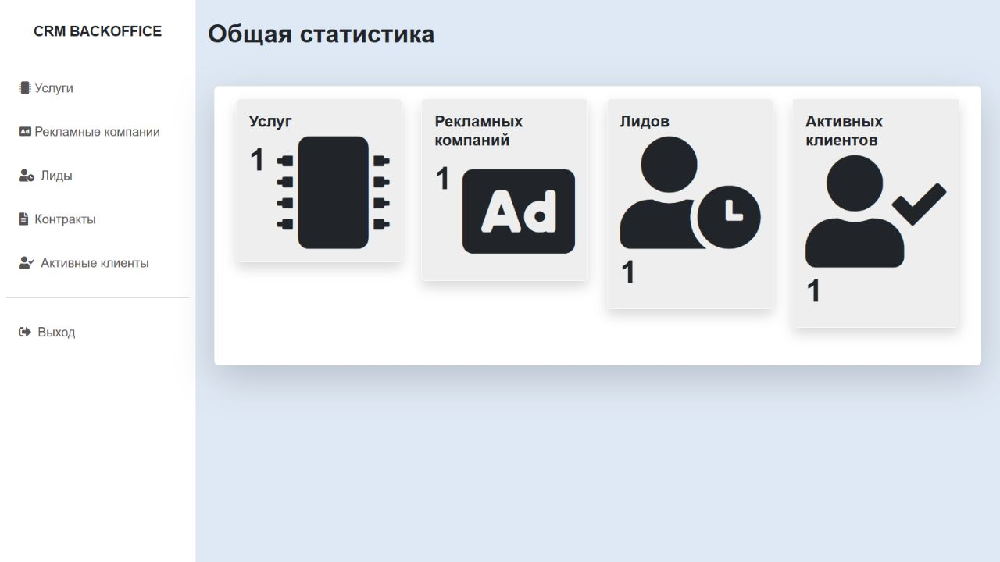
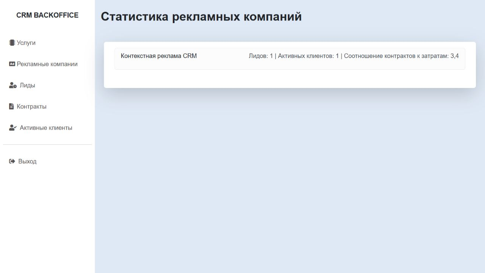

# CRM-система

[](https://github.com/Sarmagon/django-crm/actions/workflows/ci.yml)

Веб-приложение для автоматизации работы с клиентами. Система хранит услуги, рекламные кампании, потенциальных клиентов, контракты и активных клиентов, а также считает статистику эффективности рекламы.

## Стек

- Python 3.12, Django 5.2;
- PostgreSQL 16;
- Docker и Docker Compose;
- HTML-шаблоны из материалов задания;
- Pylint и встроенный тестовый раннер Django.

## Реализованный функционал

- Полный CRUD для услуг, рекламных кампаний, лидов, контрактов и активных клиентов.
- Создание активного клиента из лида с привязкой к договору.
- Страница статистики рекламных кампаний: количество лидов, активных клиентов, доход по контрактам и отношение дохода к рекламному бюджету.
- Авторизация средствами Django.
- Роли и доступ к разделам через `PermissionRequiredMixin`.
- Административная панель Django для создания пользователей и назначения ролей.
- Валидация телефона лида, уникальности названий и связей между сущностями.
- Docker-окружение с PostgreSQL и ожиданием готовности базы данных.

## Быстрый запуск через Docker

1. Убедитесь, что Docker Desktop запущен.
2. В корне проекта выполните:

```powershell
docker compose up --build
```

3. Приложение будет доступно по адресу `http://localhost:8001/accounts/login/`.

При первом запуске контейнер автоматически применит миграции и создаст группы ролей.

Остановить контейнеры можно командой:

```powershell
docker compose down
```

## Миграции

Миграции накатываются автоматически при `docker compose up`. Для ручного применения используйте:

```powershell
docker compose exec web python manage.py makemigrations --check --dry-run
docker compose exec web python manage.py migrate
```

## Тестовые данные через фикстуру

В репозитории есть фикстура `fixtures/demo_data.json`. Она создаёт одну услугу, рекламную кампанию, лида, договор и активного клиента.

После запуска контейнеров загрузите данные:

```powershell
docker compose exec web python manage.py loaddata fixtures/demo_data.json
```

Повторная загрузка фикстуры перезаписывает записи с совпадающими ID. Используйте отдельную пустую учебную БД; удалять рабочий том для демонстрации не нужно.

## Администратор и роли

Создайте администратора:

```powershell
docker compose exec web python manage.py createsuperuser
```

Перейдите в `http://localhost:8001/admin/`, создайте пользователей и добавьте их в одну из групп:

| Роль | Доступ |
| --- | --- |
| Оператор | Просмотр рекламных кампаний и работа с лидами. |
| Маркетолог | Работа с услугами и рекламными кампаниями. |
| Менеджер | Просмотр лидов и кампаний, работа с контрактами и активными клиентами. |

Аутентификацию выполняет стандартная система Django: пользователь входит по логину и паролю, пароль хранится в виде хеша. Авторизация основана на группах Django: команде `seed_roles` соответствуют разрешения моделей, а каждое представление проверяет конкретное разрешение через `PermissionRequiredMixin`. При отсутствии права Django не открывает закрытый раздел.

## Проверка качества

```powershell
docker compose exec web python manage.py test
docker compose exec web python manage.py check
docker compose exec web pylint --rcfile .pylintrc products ads leads contracts customers users crm
```

## Статус и демонстрация

Учебное приложение с реализованными моделями, CRUD, ролями, статистикой и демо-фикстурой. Демонстрационная конфигурация для локального запуска.

Для демонстрации создайте пользователей трёх ролей, загрузите фикстуру в отдельную учебную БД, войдите под каждой ролью и проверьте доступные разделы. Покажите создание услуги и кампании, лида, договора, перевод лида в клиента и изменение статистики. Скриншоты локальной демо-базы приведены ниже.


## Демонстрация

Скриншоты работающего локального приложения от 13.10.2026, в отдельном тестовом окружении. Использована учебная фикстура, вход под новым демо-администратором; это не снимки клиентской базы.





## Ограничения и безопасность

- Compose запускает `runserver`; settings содержит `DEBUG=True` и development secret. Пароли БД в Compose демонстрационные, а порты доступны на интерфейсах хоста. Такая конфигурация не подходит для открытого production-размещения.
- `.env.example` описывает параметры БД, но значения Compose заданы непосредственно в YAML. Это не обещание автоматической настройки всех параметров из `.env`.
- PostgreSQL сохраняется в томе `postgres_data`; удаление тома удаляет данные. Фикстуру загружайте только в отдельную учебную БД. Нужные данные предварительно сохраняйте.
- Права основаны на группах Django. Наличие тестов не подтверждает покрытие всех ролей и ошибок валидации. Pylint запускается отдельно; успешный CI не заявляется.
- Для production нужны внешний SECRET_KEY, `DEBUG=False`, ALLOWED_HOSTS, WSGI/ASGI-сервер, TLS, хранение media и резервное копирование.

При аудите 11.10.2026: `manage.py check` и проверка миграций прошли; 3 теста прошли на отдельной PostgreSQL. Pylint завершился с ошибками (включая настройку Django plugin, неиспользуемые импорты и длину строк); оценка 9.56/10 не является успешным прохождением. CI не добавлен.

Исправлена кнопка выхода для Django 5.2: POST-форма с CSRF вместо GET-ссылки. Регрессионный тест проверяет запрет выхода без CSRF и завершение сессии.

## Проверки

CI использует PostgreSQL 16 и выполняет три существующих теста, `manage.py check` и `makemigrations --check --dry-run`. Эти же проверки прошли локально в отдельном PostgreSQL 13.10.2026. Pylint имеет замечания и не включён в обязательный CI; наличие badge не означает прохождение Pylint.
